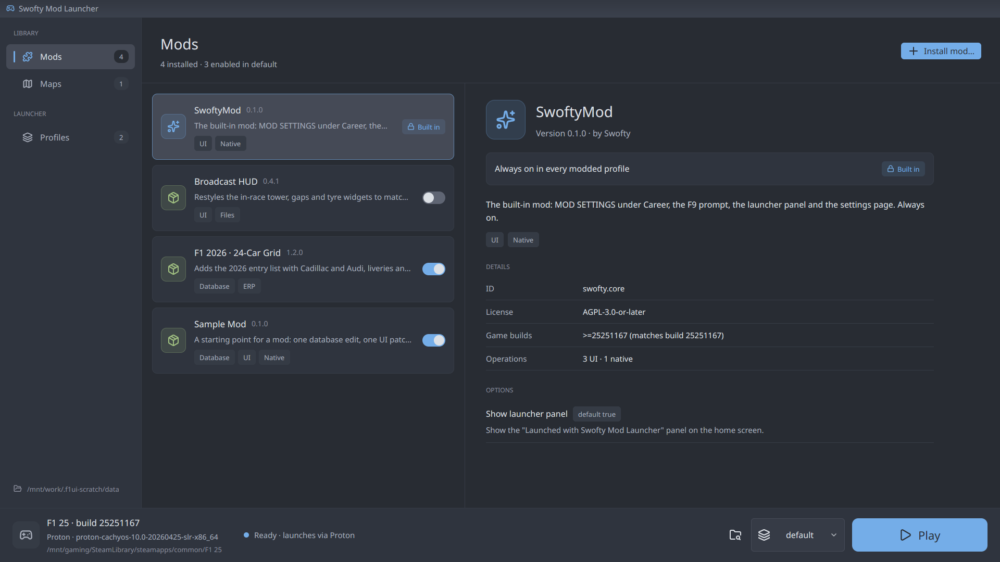

# Swofty Launcher for F1 25

A launcher and mod loader for F1 25 on Windows and Linux. Addons hook the game engine, mods add ERP and SERP content, and profiles keep separate setups.



## Features

- **Addons:** Addons use the Advanced Mod Mixin System to edit the F1 25 engine directly, from new menus and settings to bigger grids.
- **Mods:** ERPs and SERPs with no code, including community tracks such as Sepang and Okayama. A mod reaches the game in one of three ways:
  - an addon bundles it;
  - an addon loads it at runtime through the Asset API, adding, replacing or removing resources and ERPs;
  - you drop it on the launcher's Mods page, which comes from the built-in Team Simplified addon.
- **Profiles:** Keep separate setups like *Vanilla*, *26 car grid* or *Classic tracks*. The original game is restorable in one click.
- **In-game addon settings:** Change addon settings from the game's main menu, in **ADDON SETTINGS** under Career.

## Install

Follow the [installation guide](https://f1.swofty.net/guide/installation).

## Supported platforms

- Windows 10 and 11 with Steam.
- Linux with Steam and Proton, including Steam Deck, NixOS and Flatpak Steam.
- F1 25 on Steam, including the F1 2026 season content.

## Contributing

```bash
nix develop                     # development tools on NixOS
cargo fmt --all --check
cargo clippy --all-targets -- -D warnings
cargo test                      # set F1_25_DIR to test with your game files
cargo run -p swofty-launcher
native/build.sh
native/test/run_wine_test.sh
pnpm install
pnpm docs:dev
```

See the [development guide](https://f1.swofty.net/reference/development) for build details.

## Licence

[GNU Affero General Public License, version 3 or later](LICENSE). The plugin SDK in `packages/sdk` and the addon template in `templates/addon` use the MIT licence. The docs theme adapts MIT-licensed CSS from the Geode docs; see [THIRD_PARTY.md](THIRD_PARTY.md).
