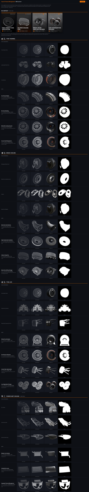

# R&D: Tyres & Thermal Management

A Swofty Launcher addon for F1 25 that adds one brand-new top-level career R&D
department, **Tyres & Thermal Management**, alongside the stock four
(Aerodynamics, Chassis, Durability, Powertrain). A new department is not a pure
database edit: the department enum lives in `F1_25.exe`, so this addon pairs
database rows with a native engine mixin. See `native/HOOKS.md` for the
reverse-engineering verdict and the exact hook site.

## The department

Tyres & Thermal Management is a real engineering discipline currently split
between Chassis and Durability. Since v0.9.0 its upgrades use their own upgrade
types, minted natively, so they never dilute Chassis' stock Tyre Wear upgrades:

- `Tyre Thermal` - tyre heat build-up
- `Brake Cooling` - brake heat transfer
- `Tyre Life` - tyre wear, stacking with Chassis' Tyre Wear
- `Power Unit Cooling` - engine heat rejection (conditional branch)

The tree is in "v0.9.0 — the full upgrade tree" below. Up to v0.8.0 three test
nodes reused the stock `Tyre Wear`, `Brakes` and `Upgrade All Durability` types.

## Enum value: 4 (the "Tyres" spare)

The team-department enum in `F1_25.exe` is a single case-insensitive FNV-1a-64
switch that resolves `Powertrain=1`, `Chassis=2`, `Aero=3`, `Tyres=4`,
default/unknown `=0`. The token **Tyres (=4) is a defined-but-unused spare**:
reading the shipping database (742,857 records) finds no row whose `department`
value is `Tyres`, and no other `Tyres` department token anywhere. The four
shipping `UpgradeDepartmentEntry` rows carry `department` values `Engine`,
`Durability`, `Chassis`, `Aerodynamics`.

So the new department claims value 4 by writing `department = "Tyres"`: the
engine already resolves it natively, and it cannot collide with a shipped
department. No new enum value is minted.

## Build plan

### Data (`operations.database`)

1. `db/departments.json` - a new `UpgradeDepartmentEntry_4` row in the two
   containers the runtime department loader actually reads,
   `{5e21a18f9f59dbf6}` and `{1f304d36c3c2b947}` (each ships
   `UpgradeDepartmentEntry_0..3` = Aero/Chassis/Durability/Powertrain and
   `_UpgradeDepartmentEntry_instancecount_ = 4`). The row is cloned
   field-for-field (all 21 keys, same types) from the stock Durability row so
   every backing `MyTeam_RND_*` attribute reference still resolves (a missing key
   crashes the game). Only two fields change: `_metadata_` =
   `ModifierTyresThermal`, `department` = `Tyres`. The row count is **not** set in
   data - the native mixin bumps it to 5 at the source (see Code below), which is
   what makes the loader's `for i in 0..count-1` read our row `_4` as the fifth.

   (The static containers `{016caf2bb4d4f128}`/`{3121442cecc7bb08}` an earlier
   read-only pass used - rows at `_4..7`, no `_instancecount_` key - are a
   different, unread copy; the live `rnd-probe` loop proved the loader reads
   indices `0..3` from `{5e21…}`/`{1f30…}`.)
2. `db/tyres_tree.json` - (v0.4–v0.8; v0.9.0 replaced it with the generated
   full tree, see "v0.9.0 — the full upgrade tree") a small three-node upgrade
   tree (Tyre Wear, Brakes, Upgrade All Durability), each node a field-for-field clone of the stock
   `fake.upgrade_0` hub schema. **Lookup RESOLVED (v0.4.0):** `Career_Load_UpgradeRows`
   (0x143539bc0) opens the tree container by dept NAME, `<team_link>.<deptname>`,
   with `k_Career_UpgradeDeptNameTable[4] = "fake"` - so the 5th department's tree
   is the `<team_link>.fake` container, a naming convention, not a data key on the
   dept row. Each record is classified by its own `upgrade_department` -> ENUM A,
   and the page shows records whose ENUM A matches its code, so the rows set
   `upgrade_department = "Fake"` (ENUM A = 4) - NOT "Tyres" (which resolves to 0
   and would collide with Aero).

   **Container RESOLVED (v0.4.1, live in-game diagnostic).** The code-4 tree is
   read per-save from `upgrades.2026.trees.<team_link>.fake`, where `team_link`
   resolves to the team's **engine-supplier constructor** token, NOT the
   constructor and NOT a generic `user_defined` hub. A McLaren (Mercedes PU) save
   opens `upgrades.2026.trees.mercedes.fake` = `{deae0310dc31dce2}`
   (`_upgrade_instancecount_` key `{b2932bd32df83903}`, `upgrade_0._metadata_` key
   `{cabec8fb14f94a7a}` - all three match the live diagnostic). The gamedb holds
   **46 real `.fake` hub containers** (each carries the shipped
   `fake.upgrade_0 = central_fake_upgrade` hub, `_upgrade_instancecount_ = 1`, same
   15-key schema). 12 are `upgrades.2026.trees.<team>.fake` for `ferrari`,
   `force_india`, `gm_cadillac`, `haas`, `mclaren`, `mercedes`, `redbull`,
   `renault`, `sauber`, `tororosso`, `user_defined`, `williams`; the other 34 are
   additional verified-identical fake hubs (per-save/variant copies) carried by
   hash. The 2025-season team trees do not exist, and the
   `engine_suppliers.trees.engine_supplier_upgrades_N.fake` containers (e.g.
   `{3c55d614fc76ce3e}`) are **empty** (no hub, no instancecount) so they are not
   written. The three `user_defined.fake` family hubs the v0.4.0 note mislabelled
   (`{ae8319a01aa30478}`, `{5927ed801bdb6765}`, `{75a045fd77ae52b9}`, plus the
   named `{f71aa592926ce9d9}` = `user_defined`) are four of these 46 real hubs and
   now carry the corrected rows (kept, not removed - they are real per-save
   targets).

   The 3 nodes ship as `upgrade_1/2/3` into **all 46** containers (the shipped
   `upgrade_0` hub is preserved, `_upgrade_instancecount_` bumped 1 -> 4), each a
   field-for-field clone of that container's own stock `fake.upgrade_0` schema (all
   15 keys, matching type tags). Keys use the per-container
   `{container_hash}.upgrade_N.<field>` scheme the addon DB-op engine resolves as
   `fnv1a64_from(container_hash, ".upgrade_N.<field>")`, verified against the real
   GVDB keys and applied end-to-end through the engine (0 stock collisions,
   gamedb round-trip stable).

   **Reachability RESOLVED (v0.4.1).** The whole career R&D tree is one graph
   rooted at the `fake` hub node `default` (`central_fake_upgrade`, grid `0,0`),
   which links OUTWARD (child/unlock edges) to each department's branch root by the
   target node's `_metadata_` id (e.g. `gearbox_durability_1`). A node is
   reachable/buyable only if a directed path from `default` reaches it. So the fix
   attaches the Tyres branch exactly as a stock department attaches to the hub: the
   hub's `links` list gains our root (`fake.upgrade_0.links` += `,tyres_thermal_1`,
   preserving the stock branch targets), then `tyres_thermal_1` -> `tyres_thermal_2`
   -> `tyres_thermal_3` chain outward. (The v0.4.0 rows linked backward - child to
   hub - and never attached the hub to the branch, so they were unreachable even
   in the wrong container.) The `attach_tyres_tree` native hook stays as-is
   (read-only logging). Remaining in-game-test item: confirm the branch renders and
   is buyable (link-gated vs. facility-gated buyability is the one thing static
   analysis cannot settle; the hub-link attach is the stock-faithful, strictly-safer
   choice either way).

### Text (`operations.assets`)

`assets/text.json` - `lang.set` strings for the department name and description
under several candidate keys. The exact key the R&D UI binds for a department
name is unverified (see Residual unknowns), so the strings cover the likely
conventions.

### Code (`operations.native`)

`native/rnd_departments.dll` - two independently-gated mid-function hooks:

- **Hook A (team-dept enum store)** `mov byte [rdi+0x340], cl`; signature
  `75 06 B1 03 EB 02 31 C9 88 8F 40 03 00 00`. When the token being resolved is
  `Tyres` it forces the stored enum byte to 4 (a confirm/activate of the spare,
  never a new value); every resolution is logged.
- **Hook B (department row count)** `mov [rsi+0x200], ecx` @`0x1445a28df` inside
  `Gdb_Init_TableCursor`; signature `89 8E 00 02 00 00 48 81 C4 20 01 00 00`
  (KB binding `gamedb.dept_count_store`). This is the single point where the
  `UpgradeDepartmentEntry` row count (from
  `<container>._UpgradeDepartmentEntry_instancecount_`, stock 4) is written into
  the cursor. The handler only acts when the cursor's row word (`cursor+0x100`)
  is `UpgradeDepartmentEntry` and the count is the stock 4, forcing it to 5, so
  every consumer that inits that table cursor agrees. The loader then reads
  `UpgradeDepartmentEntry_0..4`, i.e. our row `_4`.

Hooks A and B are gated on an exactly-one scan match - on 0 or >1 matches (or a
failed install) they log and install nothing, so the DLL stays benign.

The same DLL also carries the R&D > Performance UI rework:

- **Colour groundwork** (v0.2.0) - `k_Career_RnDDeptColourTable[4]`
  (`0x145755e88`, the stock white spare the fifth card reads via the `< 6` bound
  in the card constructor) is written to a distinct Tyres colour (`0xff0078ff`,
  orange). The write only happens after a layout probe confirms all six colour
  entries match the decompile on this build (`[0]=ffeead00 [1]=ff3ec58d
  [2]=ff16deff [3]=ff7a2aed [4]=[5]=ffffffff`); on any mismatch nothing is
  written.
- **The live 5th box** (v0.3.0) - a real fifth `Career_Construct_RnDDeptCard` for
  Tyres & Thermal Management is injected into `Career_Build_RnDDeptBoxGrid`
  (`0x141c85f70`) so the stock grid renders a fifth department box. Behind its own
  independent gate (one unique `.xtls` scan, hook site `0x141c86567`) and a
  feature flag (`render_fifth_box`, default on), separate from Hooks A/B and the
  colour write. The card vector (six pointers) is grown to seven, a 0x950 card is
  built the game's way with name `lng_rnd_dept_tyres`, a borrowed `aero` icon
  frame (no new texture) and enum 4 (colour slot [4]), and the builder's own
  attach loop binds it. The `< 4` selection clamp is left intact, so the box only
  renders; it is never the selected card. Full mechanism + addresses in
  `native/HOOKS.md`.

**Correction to the earlier scoping note.** The dept card's compile-time
`%s.%s.%s` argument is the **icon atlas path**
(`<pkg>.rnd_dept_icons_small.<frame>`), not a per-dept UIDF node path; the name is
a separate lang-key argument. So a dept card needs **no authored UIDF node** and
**no launcher UIDF/ERP pipeline** - it renders through the same card VM node the
stock four use. The v0.2.0 note claiming a fifth box needs an unbuilt UIDF node
was based on a misread of the card constructor arguments.

**The 5th pie slice (v0.4.0, partial, flag `render_fifth_pie`, default off).** The
live Performance-page pie is built by `Career_Build_RnDPieOverview` (`0x141f46eb0`,
+ populate `0x141f48030`) - NOT `Career_Build_RnDPotentialPie` (`0x141f41d60`,
dormant here). v0.4.0 grows its `0x900` (`0x80 + 4*0x220`) per-slice buffer to
`0xb20`, constructs a real 5th slot (`FUN_141f45650` @ buf+0x900), and relaxes the
`code < 4` populate guard so dept code 4 is populated - all faithful extensions of
the stock prologue (not blind). DEFERRED: the **5th pie-wedge authored in art**
(four 90-degree sector nodes) and the jump-table `case 4` name/colour; code 4 falls
to the default case (name `error_department`, white) and its sector node resolves
to an empty handle, so the slice is populated but no wedge draws yet. See
`native/HOOKS.md` for the exact sites. v0.7.1 correction: `FUN_141f45650` is the slot
destructor and the v0.4.0 "construct" hook never ran on a live buffer, so slot 4 was
uninitialised heap and the populate crashed at career load. The buffer is now `0xb40` (five
slots + a footer), slot 4 is constructed right after the stock ctor `FUN_14180c490` and
destroyed with the stock four, and populate only touches it after a registry + footer +
vtable check (`native/HOOKS.md` v0.7.1).

## v0.4.0 status summary

| piece | flag | shipped | deferred |
|---|---|---|---|
| 5th box visible cell | `render_fifth_box_layout` | read-only slot-vector diagnostic (cause resolved: no authored +0x270 slot / scene cell) | authored/cloned 5th slot + scene rect |
| upgrade tree | `attach_tyres_tree` | 3 nodes in all 46 real `trees.<team_link>.fake` hubs (`upgrade_department=Fake`), instancecount 1->4, hub `links` attach + outward chain, + container-confirm hook | branch render/buyability confirm + rating integration (in-game test) |
| 5th pie slice | `render_fifth_pie` (off) | buffer grow + 5th slot + guard relax | authored wedge geometry + jump-table case 4 |

## v0.5.0 — the 5th department SELECTION (flag `select_fifth_dept`, default on)

The code-4 (`Fake`/Tyres) department is now made SELECTABLE so its upgrade page can
be the active one. The tile data for code 4 is already loaded; the only blocker is
that the active-department index (the global `DAT_145f93c08`) is clamped `< 4` at
every non-pie read site, so dept 4 can never be the active page.

The crash trap is the department name table `k_Career_RnDDeptNameTable`
(`0x145755e58`, four entries): the colour table immediately follows it, so a naive
clamp relax makes the box grid read `nameTable[4]` = `colour[0]` and dereference it
as a `char*` → crash. So the fix is ordered:

1. **Name-guard first.** A safetyhook MidHook at the box-grid name read
   (`0x141c86c9b`) returns a static `"Tyres & Thermal Management"` C-string for
   index 4, so `nameTable[4]` is never dereferenced. Installed before any clamp is
   relaxed and always active once installed.
2. **Relax the box-grid clamp** `cmp al,4` → `cmp al,5` (`0x141c86c88`), only after
   the name hook is live.
3. **Relax the tile-page clamp** `cmp al,4` → `cmp al,5` (`0x1423380f3`, the TeamHQ
   MyTeam VM command handler at `0x142337ff0`). That site indexes a different
   4-entry table whose `[4]` is a valid string, so it does not crash.

Independently gated (two unique `.xtls` scans + the flag); benign on any miss. The
box-grid on-screen RECT and the pie wedge remain the separate authored-asset
follow-ups. Whether the `@rows`/`@tiles` spawner then renders the Fake(4) tiles is
the in-game test (see `native/HOOKS.md`).

| piece | flag | shipped | deferred |
|---|---|---|---|
| 5th dept selection | `select_fifth_dept` | name-guard + box-grid and tile-page active-dept clamp relax (dept 4 selectable, crash trap closed) | tiles-render confirm (in-game test); box RECT + pie wedge (authored art) |

## v0.6.1 — the Develop Upgrade screen

| piece | flag | shipped |
|---|---|---|
| Back from a Tyres upgrade's detail screen | `tyres_upgrade_screen` | the container's tab-open dispatch routes `tyres`/`error_department` to the Tyres tab (Durability if it has no slot); also fixes the perks back and linked-upgrade jumps |
| department economy | data | `UpgradeDepartmentEntry_4.department = Fake` (was `Tyres` → enum 0, which overwrote Aero's attributes): Tyres gets Durability's slots, rush, cost/time scales |
| card art, department icon, card colour | `tyres_upgrade_screen` | borrowed stock parts (`tyre_blankets`, `calipers`, `turbo_charger_wear_1`), `chassis` icon, Tyres orange |
| vehicle performance comparison | `tyres_upgrade_screen` | Tyre Wear/Brakes compare on Chassis, Upgrade All Durability on Durability |
| department tag over the title | lang | `lng_rnd_dept_tyres` = "Tyres" (the Tyres tab shows the same key) |
| upgrade names | lang | `lng_rnd_<upgrade_name>` (+ `_description`) |

## v0.7.0 — the five-sector pie

R&D > Performance gets five overview tiles (3+2) and a five-sector development-potential pie with
Tyres (orange, 90°-162° counter-clockwise from 3 o'clock) between Aero and Chassis, shipped as ERP
operations over `flow_career_hub.erp` and `flow_team_hq.erp` (`erp/rnd_fifth_pie.json`, `ui/`). The
native half (`native/src/rnd_fifth_pie.cpp`) names the fifth slot and tile `tyres`, routes its focus
and publishes `department_performance.tyres`. `render_fifth_pie` is on by default; its three
sub-options are `pie_tyres_slice`, `pie_tyres_focus` and `pie_tyres_performance`. Needs a launcher
with the size-changed archive rewrite (origin/main after PR #138).

## v0.7.2 — the five-sector pie draws, and the Tyres tile behaves like the stock four

| piece | flag | change |
|---|---|---|
| five-sector pie on R&D > Performance | assets | the engine resolves an eXRef by its `xref` id (md5-64 of the scene path), not by `fileRef`; v0.7.1 re-pointed only `fileRef`, so `chart_1` still drew the stock pie. `chart_1` and the five sectors now carry the ids of `rnd_dev_potential5.idf` / `rnd_dev_potential_sect72.idf`. The Team HQ research overview keeps the stock four-sector pie (own scene chain, four tiles, no Tyres focus) |
| Tyres tile fitted/total and ring | `pie_tyres_counts` + `.ui` | the tile-count pass (0x141f49bc0) counts code 4 into slot 4 behind a slot-4 gate; `focusable.trigger` now refreshes the Tyres tile |
| Tyres icon and colour in R&D lists | `tyres_dept_tags` | In Progress, category rows, perks title, Team HQ popups, upgrade cards: borrowed stock frames (`maintenance` department icon, the stock category icon of the upgrade type) and the Tyres orange |
| Tyres tile opens the Tyres page | `pie_tyres_open` | a "Tyres is the focused tile" flag picks the Tyres tab as the departments screen's first tab and restores the Tyres focus on the Performance page |

Details, sites and expected log lines: `native/HOOKS.md` v0.7.2.

## v0.8.0 — the Tyres department icon

| piece | flag | change |
|---|---|---|
| tyre icon frames | `tyres_icon` (db, default on) | `erp/rnd_tyres_icon.json` appends a `tyres` slice to `rnd_dept_icons_small` (48×48 white) and `rnd_wheel_icon` (60×60 Tyres orange), and a `rnd_tyres_strip` slice (1112×4 orange) to `rnd_department_strips`, in the plain and `rnd_om_xm` lists, with the matching `overrides.uidb` entries |
| Tyres surfaces use them | none (follows the assets) | the Tyres tile, the 5th box card, the R&D list department icon, the Develop Upgrade card art and the In Progress strip name the new frames when `flow_career_hub.erp` carries all six grown arrays; otherwise the 0.7.2 borrowed frames |

The icon is authored as `icons/tyres.svg` (a slick F1 tyre with a sidewall stripe, a five-spoke rim at half alpha and three heat waves) and rasterised by `tools/build_icons.py`. The game's UI takes no vector art: every icon is a BC7 slice of a texture array. Details: `native/HOOKS.md` v0.8.0.


## v0.9.0 — the full upgrade tree

`tools/build_tree.py` generates `db/tyres_tree.json` and the upgrade names and descriptions in
`assets/text.json`. It compares its build with the shipped files and exits 1 on a difference;
`--write` replaces them.

```sh
python3 addons/rnd-tyres-thermal/tools/build_tree.py --write
python3 addons/rnd-tyres-thermal/tools/build_tree.py --write --no-pu-cooling
python3 addons/rnd-tyres-thermal/tools/build_tree.py --game "<F1 25>"
```

`--no-pu-cooling` leaves out branch D (rows 13-15), so the tree has 12 upgrades and
`_upgrade_instancecount_` 13. `--game` takes the F1 25 folder or a stock
`gamedatabases.2025.bin`, and checks the hub table, that no row key exists in stock and that no
grid cell is taken in the sibling stock trees of each hub.

### Stock calibration

Read from the stock `gamedatabases.2025.bin` (Steam build 25251167, `swofty verify` clean), over
the 46 trees the addon attaches to: the 12 named `upgrades.2026.trees.<team_link>` trees and 34
more reached by hash (24 with the named trees' row counts, 22 with Aero 24, Chassis 23,
Durability 21, Powertrain 16 or 17 rows). No `upgrades.2025.trees.*` path exists. The economy does
not vary by team, tree family or department, only by size:

| department | size | rows (Mercedes 2026) | `cost` | `cost_to_develop` | research days | develop days | `weighting` | `unlock_at_facility_level` (all 46 trees) | `supplier_delivery_date_index` |
|---|---|---|---|---|---|---|---|---|---|
| Aerodynamics | Minor | 13 | 500 | 1000 | 20 | 25 | 1.0 | 0 68%, 1 17%, 2 15% | -1 |
| Aerodynamics | Major | 9 | 1000 | 1000 | 30 | 25 | 2 | 0 64%, 3 20%, 2 14%, 1 2% | -1 |
| Aerodynamics | Ultimate | 3 | 1500 | 1000 | 40 | 25 | 3 | 3 70%, 4 30% | -1 |
| Chassis | Minor | 12 | 500 | 1000 | 20 | 25 | 1.0 | 0 84%, 1 16% | -1 |
| Chassis | Major | 7 | 1000 | 1000 | 30 | 25 | 2 | 0 43%, 2 42%, 1 16% | -1 |
| Chassis | Ultimate | 4 | 1500 | 1000 | 40 | 25 | 3 | 0 46%, 3 32%, 4 23% | -1 |
| Durability | Minor | 6 | 500 | 1000 | 20 | 25 | 1 | 0 100% | -1 |
| Durability | Major | 6 | 1000 | 1000 | 30 | 25 | 2 | 0 91%, 1 6%, 2 3% | -1 |
| Durability | Ultimate | 6 | 1500 | 1000 | 40 | 25 | 3 (1 on `turbo_charger_durability_3`) | 3 81%, 4 14%, 2 5% | -1 |
| Powertrain | Minor | 8 | 500 | 1000 | 20 | 25 | 1.0 | 0 85%, 1 12%, 2 3% | -1 |
| Powertrain | Major | 6 | 1000 | 1000 | 30 | 25 | 2 | 0 35%, 1 33%, 2 32% | -1 |
| Powertrain | Ultimate | 3 | 1500 | 1000 | 40 | 25 | 3 (4 on 2% of rows) | 3 72%, 4 28% | -1 |
| hub (`fake`) | none | 1 | 0 | 1000 | 20 | 25 | 1.0 | 0 | -1 |

Every upgrade row, the hub included, carries the same 15 keys and no others: `_metadata_` (2),
`upgrade_name` (2), `upgrade_type` (3), `upgrade_size` (3), `upgrade_department` (3), `cost` (0),
`cost_to_develop` (0), `weighting` (1), `unlock_at_facility_level` (0),
`supplier_delivery_date_index` (0), `links` (13), `fitting_times.num_days_to_research` (0),
`fitting_times.num_days_to_develop` (0), `grid_coordinates.x` (1), `grid_coordinates.y` (1).
`upgrade_name` is the card-art frame (`om_xm_*`) and is the only field that varies between the
named teams' trees.

Layout: the trees of one team share one grid around the hub `default` at (0,0). Aerodynamics
grows up (x −3…3, y −3…−10), Chassis right (x 3…10, y −3…3), Durability down (x −3…4, y 4…8)
and Powertrain left (x −11…−4, y −2…2). A chain steps one unit per node (Durability's gearbox
column is (0,4) → (0,5) → (0,6)); category lines sit one unit apart. `links` is the outward list
of child labels, the node's own chain first and cross-branch children after it; a leaf has an
empty list. The hub's `links` names each department's branch roots.

### Our values

Tyres uses Durability's economy (v0.6.1), so the tree takes the stock curve per size and
Durability's facility levels: Minor and Major 0, Ultimate 3. An Ultimate starts facility-locked
(`SetFacilityLocked(unlock_at_facility_level != 0)` at init) and unlocks through
`Upgrade_EvalFacilityLock`, which reads department 4's modifiers, i.e. Durability's attributes on
the `Fake` department row. That path is untested in game; if the Ultimates stay locked, set
`SIZES['Ultimate']['facility']` to 0.

| row | `_metadata_` | `upgrade_name` | `upgrade_type` | size | `cost` / `cost_to_develop` | days (research / develop) | `weighting` | facility | grid (x, y) | `links` |
|---|---|---|---|---|---|---|---|---|---|---|
| 1 | `tyres_thermal_1` | `tt_thermal_model` | Tyre Thermal | Minor | 500 / 1000 | 20 / 25 | 1.0 | 0 | 6, 5 | 2 |
| 2 | `tyres_thermal_2` | `tt_rim_heat_shield` | Tyre Thermal | Minor | 500 / 1000 | 20 / 25 | 1.0 | 0 | 6, 6 | 3 |
| 3 | `tyres_thermal_3` | `tt_rim_cooling` | Tyre Thermal | Major | 1000 / 1000 | 30 / 25 | 2 | 0 | 6, 7 | 4 |
| 4 | `tyres_thermal_4` | `tt_carcass_heat` | Tyre Thermal | Ultimate | 1500 / 1000 | 40 / 25 | 3 | 3 | 6, 8 | |
| 5 | `tyres_thermal_5` | `bc_duct_inlet` | Brake Cooling | Minor | 500 / 1000 | 20 / 25 | 1.0 | 0 | 7, 5 | 6 |
| 6 | `tyres_thermal_6` | `bc_disc_ventilation` | Brake Cooling | Minor | 500 / 1000 | 20 / 25 | 1.0 | 0 | 7, 6 | 7, 13 |
| 7 | `tyres_thermal_7` | `bc_caliper_fins` | Brake Cooling | Major | 1000 / 1000 | 30 / 25 | 2 | 0 | 7, 7 | 8 |
| 8 | `tyres_thermal_8` | `bc_drum_package` | Brake Cooling | Ultimate | 1500 / 1000 | 40 / 25 | 3 | 3 | 7, 8 | |
| 9 | `tyres_thermal_9` | `tl_sidewall_load` | Tyre Life | Minor | 500 / 1000 | 20 / 25 | 1.0 | 0 | 9, 5 | 10 |
| 10 | `tyres_thermal_10` | `tl_pressure_telemetry` | Tyre Life | Minor | 500 / 1000 | 20 / 25 | 1.0 | 0 | 9, 6 | 11 |
| 11 | `tyres_thermal_11` | `tl_camber_wear` | Tyre Life | Major | 1000 / 1000 | 30 / 25 | 2 | 0 | 9, 7 | 12 |
| 12 | `tyres_thermal_12` | `tl_low_deg_package` | Tyre Life | Ultimate | 1500 / 1000 | 40 / 25 | 3 | 3 | 9, 8 | |
| 13 | `tyres_thermal_13` | `pc_radiator_core` | Power Unit Cooling | Minor | 500 / 1000 | 20 / 25 | 1.0 | 0 | 8, 6 | 14 |
| 14 | `tyres_thermal_14` | `pc_cooling_louvres` | Power Unit Cooling | Major | 1000 / 1000 | 30 / 25 | 2 | 0 | 8, 7 | 15 |
| 15 | `tyres_thermal_15` | `pc_integrated_thermal` | Power Unit Cooling | Ultimate | 1500 / 1000 | 40 / 25 | 3 | 3 | 8, 8 | |

`links` lists child rows (`tyres_thermal_<n>`). Every row has `upgrade_department` `Fake` and
`supplier_delivery_date_index` -1. The hub's `links` keeps its stock targets and gains
`tyres_thermal_1,tyres_thermal_5,tyres_thermal_9`; `_upgrade_instancecount_` is 16 (13 without
branch D).

The block sits in the free quadrant between Chassis and Durability, two units clear of both, in
four columns one unit apart. Branch D hangs off B2 in the column next to B, so no link crosses a
column; without it, Tyre Life moves to x = 8.

```
        x=6   x=7   x=8   x=9
  y=5   A1    B1    .     C1        A  Tyre Thermal
  y=6   A2    B2 -> D1    C2        B  Brake Cooling
  y=7   A3    B3    D2    C3        C  Tyre Life
  y=8   A4    B4    D3    C4        D  Power Unit Cooling
```

Row numbers are fixed per upgrade (A 1-4, B 5-8, C 9-12, D 13-15): the native hooks recognise our
instances by `djb2("tyres_thermal_<n>_255")`, and a save stores each instance's state under that
hash, so dropping branch D never renumbers the core twelve. Saves made with v0.8.0 or earlier
carry states for `tyres_thermal_1..3`; they land on A1-A3.

### The card art and category icons

Every upgrade has its own card art, modelled and rendered in Blender by `art/src/` to the stock
2026 card look (`art/STYLE.md`, `art/preview.html`): a grey wireframe while available, the same
wireframe in white while in progress, a full-colour render once fitted, and a mask. The four
upgrade types have their own 32×32 category icons.



`tools/build_card_art.py` encodes the 64 frames as BC7 (mode 6, `tools/bc7enc.py`) and appends
them to the stock texture arrays in every UI archive that carries them, with the matching
`overrides.uidb` entries (`erp/rnd_tyres_card_art.json`, `art/arrays/`, setting
`tyres_card_art`, db, default on). Stock slices and stock list entries stay byte-identical.

| list (`overrides.career.`) | archives | our frames | indices |
|---|---|---|---|
| `rnd_om_xm.rnd_part_image` | `common_flow_misc`, `flow_team_hq` | `om_xm_<name>`, `om_xm_<name>_progress`, `om_xm_<name>_complete` | 337-381 |
| `rnd_om_xm.rnd_part_mask` | `flow_r_and_d`, `flow_team_hq` | `om_xm_<name>_m` | 110-124 |
| `rnd_part_image` (pre-2026) | `common_flow_misc`, `flow_team_hq` | `<name>`, `<name>_in_progress`, `<name>_complete` | 362-406 |
| `rnd_part_mask` (pre-2026) | `flow_r_and_d`, `flow_team_hq` | `<name>` | 120-134 |
| `rnd_om_xm.rnd_category_icons` | `flow_career_hub`, `flow_team_hq` | `tyres_tyre_thermal`, `tyres_brake_cooling`, `tyres_tyre_life`, `tyres_pu_cooling` | 20-23 |
| `rnd_category_icons` (pre-2026) | `flow_career_hub`, `flow_r_and_d`, `flow_team_hq` | the same four | 21-24 |

Upgrades go in tree order (A1-A4, B1-B4, C1-C4, D1-D3), three states each in the image lists.
The card binders ask for `<upgrade_name>`, `<upgrade_name>_in_progress` or
`<upgrade_name>_complete` and the mask `<upgrade_name>`; the native card-art hook turns that
into the list's own name for the state (`native/HOOKS.md`, "v0.9.0 — the card art"). Category
frames follow the stock `<department>_<type>` names with the Tyres department frame `tyres`.

## Residual unknowns (the in-game test resolves these)

- **Does the game read the 5th department row?** Resolved by RE + the live
  `rnd-probe` trace: the count comes from the DB key
  `<container>._UpgradeDepartmentEntry_instancecount_` (= 4), read by
  `Gdb_Init_TableCursor` and used as the loader's `for i in 0..count-1` bound.
  The loader reads indices `0..3` from `{5e21a18f9f59dbf6}`/`{1f304d36c3c2b947}`.
  The native Hook B bumps that count to 5 so index `4` (our row) is read.
  **Resolved in v0.6.1:** `department = Tyres` mapped to ENUM A = 0 and overwrote
  Aero's attribute maps; the row now says `Fake` (= 4), a distinct 5th entry. Whether a distinct 5th *tab* then
  renders (the tab list may enumerate via a different path) is the test question.
- **UI box visibility (v0.4.0 RESOLVED cause).** The v0.3.0 5th card is attached
  but invisible because the box grid's container (`builder+0x2d8`, a UITC tab VM)
  only shows departments that have an entry in the authored slot vector
  `builder+0x548..+0x550` (`container+0x270`), created at screen init from authored
  tab/scene nodes (a fixed four) - the per-card attach never adds a slot. A visible
  5th cell needs a 5th authored/cloned slot + a 5th `rnd_card_with_info` scene rect
  (the scene authors only four). The `render_fifth_box_layout` diagnostic captures
  the slot/card vectors in-game so that follow-up (external ERP scene patch, or a
  runtime slot clone) has ground truth. See `native/HOOKS.md`.
- **Upgrade-tree attachment (v0.4.1 RESOLVED).** `Career_Load_UpgradeRows` opens
  the tree by dept NAME, `upgrades.2026.trees.<team_link>.fake` for code 4, where
  `team_link` is the team's engine-supplier constructor token (McLaren save ->
  `mercedes` -> `{deae0310dc31dce2}`, matching the live diagnostic). The Tyres
  rows ship in all 46 real `trees.<team_link>.fake` hub containers as
  `upgrade_1..15` (`upgrade_1/2/3` up to v0.8.0; `upgrade_department=Fake`,
  ENUM A=4), attached to the hub `default` via its `links` list and chained
  outward. v0.7.2 confirmed three rows render and can be bought. Open for v0.9.0:
  all 15 rows on the page, the facility lock on the Ultimates, and the rating
  integration of the new types (in-game test).
- **Save tolerance** - whether a career save accepts the new row/enum value.
- **Enum overflow** - no fixed array keyed by the department byte was found
  (the loader's embedded sub-arrays have ~18 slots), but value 4 in a consumer
  that only expects 0-3 is unproven.
